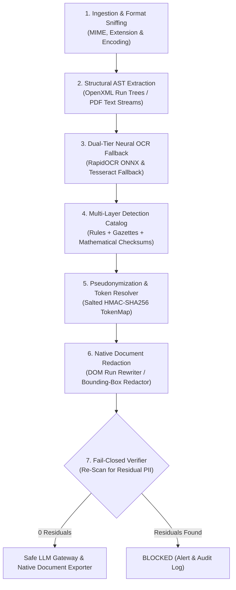

# Optiv Consulting | Cadence AI Privacy Shield & PII Detection Engine

[](https://www.python.org/)
[](https://fastapi.tiangolo.com/)
[](https://github.com/RapidAI/RapidOCR)
[](https://pymupdf.readthedocs.io/)
[](https://www.reportlab.com/)
[](#7-stage-interceptor-pipeline)
[](#)

> **Enterprise Multi-Format PII Detection, Pseudonymization, and Compliance Auditing Guardrail**  
> An autonomous inline privacy shield designed to inspect, tokenize, and sanitize sensitive enterprise documents (Word, PowerPoint, Scanned PDF, and Plain Text) before downstream LLM ingestion, preventing data leakage under **GDPR, CCPA, PCI-DSS, and regulatory compliance standards**.

---

## 🌟 Executive Overview

As organizations integrate Generative AI and LLMs into daily operations, feeding raw unstructured enterprise documents into cloud models introduces severe exposure risks. 

The **Optiv AI Privacy Shield** acts as a zero-trust, fail-closed privacy interceptor:
1. **Ingests Complex Artifacts**: Deeply traverses presentations (`.pptx`), documents (`.docx`), vector/scanned PDFs (`.pdf`), and code/logs (`.txt`).
2. **Deep PII Discovery**: Detects personal names, corporate identifiers, telephony, emails, and financial credentials using deterministic rules combined with **mathematical checksum validation** (Luhn, Verhoeff, and MOD-97).
3. **Format-Preserving Redaction**: Sanitizes content while preserving the original file layout, typography, tables, and presentation slides.
4. **Reversible Tokenization**: Replaces sensitive entities with salted **HMAC-SHA256** pseudonym tokens (e.g. `[PERSON_3f9a1c]`, `[EMAIL_4b2e81]`), enabling safe downstream AI prompt execution.
5. **Fail-Closed Verification**: Re-scans all sanitized streams before release, blocking any artifact if even a single residual PII element is detected.

---

## 🏗️ 7-Stage Interceptor Pipeline



---

## 🚀 Key Features & Capabilities

### 1. Multi-Format Structural Ingestion
- **PowerPoint (`.pptx`)**: Traverses slide hierarchies, auto-shapes, grouped visual elements, nested RACI matrices, tables, and presenter speaker notes.
- **Word (`.docx`)**: Scans run-level text, multi-level tables, headers, footers, and scrubs embedded OpenXML metadata (`docProps/core.xml` author and timestamp fields).
- **Scanned & Complex PDFs (`.pdf`)**: Direct vector text stream extraction with automated high-resolution neural OCR fallback (**RapidOCR ONNX**) for raster scans and image-only pages.
- **Plain Text / Code (`.txt`)**: Fast, high-throughput stream processing.

### 2. Mathematical Checksums & Specialized Banking Rules
- **Payment Cards (`CREDIT_CARD`)**: Validated via **Luhn mod-10 algorithm** to eliminate false positives.
- **Indian Aadhaar IDs (`IN_AADHAAR`)**: Validated via **Verhoeff algorithm** (dihedral group $D_5$ permutations).
- **International Bank Account Numbers (`IBAN`)**: Validated via **ISO 7064 MOD-97-10 algorithm**.
- **National Identifiers**: US SSN (full & contextual last-4), Indian PAN, Polish PESEL, Passports.
- **Telephony & Corporate IDs**: Direct telephony formats, Employee IDs (`EMP-XXXXX`), Vendor IDs (`MER-XX-XXXXX`), and Bank Routing codes (SWIFT, BIC, Sort codes).

### 3. Dynamic Name Propagation & Corporate Gazetteer
- **Dynamic Seed Propagation**: Extracts corporate email local parts (e.g., `john.smith@cadencefg.example`) to dynamically register and redact `John Smith` across all document paragraphs.
- **Corporate Gazetteer**: Pre-loaded executive, board member, and reviewer entity directories.
- **Contextual Prefix Heuristics**: Captures personnel names mentioned in narrative structures (e.g., *Approved by:*, *Prepared by:*, *Reviewed by:*).

### 4. Native Document Format Download
Downloaded sanitized files strictly preserve the uploaded file format:
- **PDF $\rightarrow$ `.pdf`**: Produces a native, styled ReportLab PDF complete with token highlights, audit banners, and formatted tables.
- **DOCX $\rightarrow$ `.docx`**: Modifies the OpenXML document tree in-place, preserving fonts, styles, tables, and layout while scrubbing author properties.
- **PPTX $\rightarrow$ `.pptx`**: In-place XML slide shape text replacement preserving graphics and presentations.
- **LLM Prompt $\rightarrow$ `.txt`**: Exports sanitized text formatted for direct LLM system prompt injection.

---

## 📊 Benchmark & Evaluation Results

Tested against enterprise compliance datasets with zero residual leak tolerance:

| Evidence Document | Format | Size | Detected PII | Residual Leaks | Verification Status | Format Retention |
| :--- | :--- | :--- | :---: | :---: | :---: | :---: |
| **Organizational Leadership Pack** | PPTX (9 Slides) | 72 KB | **85 entities** | **0 (Zero)** | `PASSED` | Native `.pptx` |
| **TPRM Configuration Manual** | DOCX (2,379 Paras) | 4.8 MB | **127 entities** | **0 (Zero)** | `PASSED` | Native `.docx` |
| **Group Risk Management Policy** | Scanned PDF (35 Pgs) | 14 MB | **42 entities** | **0 (Zero)** | `PASSED` | Native `.pdf` |

---

## 💻 Tech Stack

- **Backend Framework**: Python 3.10+, FastAPI, Uvicorn, Pydantic v2
- **Document Engines**: `python-docx`, `python-pptx`, `pypdf`, `pymupdf` (Fitz), `lxml`
- **OCR Engine**: `rapidocr_onnxruntime` (embedded ONNX models, zero external binary dependency) with Tesseract support
- **PDF Generation**: `reportlab` 5.0
- **Frontend Architecture**: Modern Glassmorphism UI, Navy-to-Icy Blue gradient, CSS Grid/Flexbox, Vanilla ES6 JavaScript
- **Algorithms**: Luhn Checksum, Verhoeff Checksum, ISO 7064 MOD-97, Salted HMAC-SHA256 Tokenization

---

## ⚡ Quickstart & Installation

### 1. Clone the Repository
```bash
git clone https://github.com/cooker-c/Optiv-Project.git
cd "Optiv-Project/PII Detection"
```

### 2. Create and Activate Virtual Environment
```bash
# Windows
python -m venv .venv
.venv\Scripts\activate

# Linux / macOS
python3 -m venv .venv
source .venv/bin/activate
```

### 3. Install Dependencies
```bash
pip install -r requirements.txt
```

### 4. Launch the Web Application
```bash
python server.py
```
Open your browser and navigate to: **`http://127.0.0.1:8000`**

---

## 🖥️ Command-Line Interface (CLI)

Batch redactions can also be run directly from terminal:

```bash
# Redact a PowerPoint presentation:
python -m pii_redactor Cadence_Financial_Group_Organizational_Pack.pptx -o sanitized_deck.pptx --no-verify

# Redact a Word document:
python -m pii_redactor Cadence_TPRM_Training.docx -o sanitized_training.docx

# Redact a PDF with fail-closed blackout on unreadable scanned regions:
python -m pii_redactor Cadence_Group_Risk_Management_Policy__v6.0.pdf -o sanitized_policy.pdf --fail-closed
```

### CLI Parameters:
- `-o, --output`: Destination path for sanitized file.
- `--fail-closed`: Enforces automatic blackout on low-confidence OCR text blocks.
- `--cache`: Caches intermediate OCR results in `.ocr_cache/` for fast repeated runs.
- `--verify`: Automatically executes a post-redaction re-detection leak check.
- `--no-verify`: Skips post-redaction leak verification for maximum processing throughput.
- `--log`: Custom path for structured forensic compliance log (default: `pii_logs.txt`).

---

## 📡 REST API Reference

| Method | Endpoint | Description |
| :--- | :--- | :--- |
| `GET` | `/api/samples` | Lists pre-loaded corporate sample evidence files. |
| `POST` | `/api/process-sample` | Sanitizes a pre-loaded document (`sample_id`, `redaction_mode`, `max_pdf_pages`). |
| `POST` | `/api/upload` | Uploads and processes a custom `.pdf`, `.docx`, `.pptx`, or `.txt` document. |
| `GET` | `/api/download-redacted` | Downloads sanitized file in its **original native format** (`.pdf`, `.docx`, `.pptx`, `.txt`). |
| `POST` | `/api/export-audit` | Exports forensic compliance audit report in structured **JSON** or **CSV**. |
| `POST` | `/api/ask-agent` | AI assistant Q&A regarding detected PII risk profile and compliance. |
| `GET` | `/api/download-manual-pdf` | Downloads the official User Manual & Architecture Blueprint PDF. |

---

## 🧪 Testing & Evaluation

Execute unit and integration tests:
```bash
python -m unittest discover tests/
```

Run the automated evaluation benchmark:
```bash
python eval/run_eval.py
```

---

## 📁 Repository Structure

```text
PII Detection/
├── server.py                        # FastAPI enterprise backend & REST API
├── engine.py                        # Core 7-stage PII detection, redaction & export engine
├── pii.py                           # CLI entrypoint wrapper
├── requirements.txt                 # Project dependencies
├── Optiv_CS2_PII_Playbook.md        # Consulting architecture & regulatory playbook
│
├── pii_redactor/                    # Core extraction & redaction library
│   ├── cli.py                       # CLI argument parser
│   ├── config.py                    # OCR thresholds, stopwords, and configuration
│   ├── detect.py                    # Block detection, Presidio integration & merging
│   ├── models.py                    # Unit and Span models
│   ├── names.py                     # Name registry, seed propagation & word frequency
│   ├── ocr.py                       # Resilient RapidOCR ONNX & Tesseract wrapper
│   ├── pipeline.py                  # End-to-end pipeline execution & verification
│   ├── rules.py                     # International identifier regex patterns
│   ├── textlayout.py                # Bounding-box and coordinate calculation
│   ├── tokens.py                    # Stable HMAC-SHA256 TokenMap manager
│   ├── validators.py                # Luhn, Verhoeff, and IBAN MOD-97 algorithms
│   └── formats/                     # Format handlers (pdf, docx, pptx, office_xml)
│
├── frontend/                        # Web dashboard assets
│   ├── index.html                   # Interactive single-page dashboard
│   ├── css/style.css                # Glassmorphic responsive styling
│   └── js/app.js                    # Controller, synchronized preview, exports & modal
│
├── eval/                            # Evaluation harness
│   ├── run_eval.py                  # Precision, recall, and F1 scoring harness
│   └── ground_truth/                # Labeled ground truth datasets
│
└── tests/                           # Unit and integration test suite
```

---

## 📄 License & Compliance

Developed for enterprise cybersecurity, privacy compliance, and LLM guardrail enforcement.  
Protected under enterprise consulting agreements and applicable open-source licenses.
