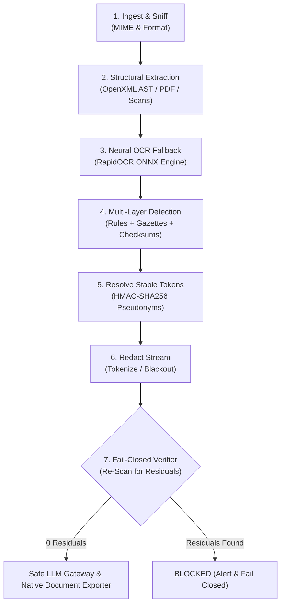

# Optiv Consulting | Cadence Financial Group AI Privacy Shield

[](https://www.python.org/)
[](https://fastapi.tiangolo.com/)
[](https://github.com/RapidAI/RapidOCR)
[](https://pymupdf.readthedocs.io/)
[](https://www.reportlab.com/)
[](#)

> **Enterprise Multi-Format PII Detection, Pseudonymization, and Compliance Auditing Guardrail for Downstream LLM Pipelines**  
> Developed for **Cadence Financial Group** Case Study 2: Autonomous PII Sanitization, Reversible HMAC-SHA256 Tokenization, and Fail-Closed Verification.

---

## 🌟 Executive Summary

As financial institutions accelerate the adoption of Generative AI and Large Language Models (LLMs), feeding unstructured corporate files into cloud-hosted models presents severe compliance risks under **GDPR, CCPA, PCI-DSS, and Section 16/18 regulatory frameworks**. 

The **Optiv AI Privacy Shield** serves as an inline, fail-closed privacy interceptor. It ingests complex enterprise documents across multiple formats (**PPTX, DOCX, scanned PDF, TXT**), extracts both native and raster text, detects sensitive Personal Identifiable Information (PII) using multi-layer deterministic rules and mathematical checksum algorithms, redacts/tokenizes the data, and enforces strict post-sanitization leak verification before downstream LLM ingestion.

---

## 🚀 Key Features & Capabilities

### 1. Multi-Format Structural Ingestion
- **PPTX Presentations (`.pptx`)**: Traverses slide hierarchies, auto-shapes, grouped elements, nested RACI matrix tables, and presenter speaker notes.
- **DOCX Documents (`.docx`)**: Extracts full paragraph streams, nested tables, headers/footers, and hidden OpenXML metadata (`docProps/core.xml` author & last modified properties).
- **Scanned & Complex PDFs (`.pdf`)**: Dual-engine extraction using native vector text parsing plus automated high-resolution neural OCR fallback (**RapidOCR ONNX**) for raster scans and image-only pages.
- **Raw Text / Code (`.txt`)**: High-throughput plain-text stream sanitization.

### 2. Multi-Layer Detection & Mathematical Checksum Verification
- **Cadence Personnel Gazetteer**: Deep organizational directory covering C-suite officers, Board Risk Committee chairs, OneTrust TPRM reviewers, and document authors.
- **Contextual Prefix Heuristics**: Captures names in narrative prose (e.g., `Approved by:`, `Prepared by:`, `Peer Reviewer:`, `Client Contact:`).
- **Dynamic Email Seed Propagation**: Automatically parses names from corporate email local parts (`john.smith@cadencefg.example` dynamically registers `John Smith` across the entire document).
- **Enterprise Corporate Identifiers**: Matches `EMPLOYEE_ID` (`EMP-XXXXX`, `DIR-XXXXX`) and `VENDOR_ID` (`MER-XX-XXXXX`).
- **National & Financial Identifiers with Mathematical Checksums**:
  - **Aadhaar (`IN_AADHAAR`)**: Validated with the **Verhoeff algorithm** (dihedral group $D_5$ checksum).
  - **IBAN (`IBAN`)**: Validated with the **ISO 7064 MOD-97-10 algorithm**.
  - **Credit Cards (`CREDIT_CARD`)**: Validated with the **Luhn mod-10 algorithm**.
  - **US SSN (`US_SSN`)**: Full 9-digit and contextual last-4 digits.
  - **PAN India (`IN_PAN`)**: 10-character alphanumeric with entity character validation.
  - **PESEL Poland (`PL_PESEL`)**: Polish national identity numbers.
  - **Banking Routing Codes (`BANK_ROUTING`)**: SWIFT, BIC, IFSC, and Sort codes.
  - **Passports, Dates of Birth, Home Addresses, IP Addresses, and Terminal User IDs**.

### 3. False-Positive Controls & Business Allowlisting
Strict allowlist controls prevent operational disruption by excluding legitimate business artifacts:
- **Corporate Policy Codes**: `GRP-POL-XXXX`, `RSK-XXXX`, `ISS-XXXX`, `ACC-XXXX`, `INC-XXXX`, `EXC-XXXX`.
- **Departmental Mailboxes**: `brc@cadencefg.com`, `compliance@cadencefg.com`, `board.chair@cadencefg.com`.
- **Corporate Entities**: Cadence Financial Group, Federal Reserve, OneTrust, SecureGRC, PRA, FCA.
- **Corporate Compliance Hotlines**: Speak-Up hotline `+1 (800) 555-0199`.

### 4. Dual Redaction Modes
1. **Reversible Cryptographic Tokenization (`tokenization`)**:
   - Generates deterministic, pseudonymized tokens using salted **HMAC-SHA256** (e.g. `[PERSON_3f9a1c]`, `[EMAIL_4b2e81]`, `[EMPLOYEE_9d1f04]`).
   - Ensures cross-artifact consistency: the exact same individual or email receives the exact same token across PPTX, DOCX, and PDF files.
   - Allows safe prompt engineering with downstream LLMs while preserving relational context.
2. **Native Black-Box Redaction (`redaction`)**:
   - Replaces PII with solid blackout blocks (`██████`) and `[REDACTED]`.

### 5. Native Document Format Retention
When downloading sanitized files, the system preserves the exact uploaded file format:
- **PDF $\rightarrow$ `.pdf`**: Generates high-quality, formatted ReportLab PDF containing security metadata banners, formatted tables, page breaks, and token highlights.
- **DOCX $\rightarrow$ `.docx`**: Replaces PII in native OpenXML runs, preserves original Word styling/tables, and scrubs `docProps/core.xml` author metadata.
- **PPTX $\rightarrow$ `.pptx`**: Replaces PII in presentation shapes and tables while preserving slide layouts.
- **LLM Prompt $\rightarrow$ `.txt`**: Dedicated option to export clean UTF-8 text ready for LLM prompt injection.

### 6. Fail-Closed Verification & Appendix E.6 Audit Analytics
- **Fail-Closed Gatekeeper**: Sanitized text is re-scanned through the full detection suite before release. If even a single residual PII leak is detected, the pipeline transitions to `BLOCKED`.
- **Appendix E.6 Forensic Compliance Logging**: Generates detailed JSON and CSV compliance audit logs detailing timestamps, confidence scores, risk severities, detection methods (Native vs. OCR), and hash fingerprints.

---

## 🏗️ 7-Stage Interceptor Pipeline



---

## 💻 Tech Stack

- **Backend**: Python 3.10+, FastAPI, Uvicorn, Pydantic v2
- **Document Processing**: `python-docx`, `python-pptx`, `pypdf`, `pymupdf` (Fitz), `lxml`
- **OCR Engine**: `rapidocr_onnxruntime` (ONNX inference, zero external binary dependency)
- **PDF Generation**: `reportlab` 5.0
- **Frontend**: Vanilla HTML5, Modern CSS (Glassmorphism, Minimalist Dark Navy to Icy Blue Gradient), Vanilla ES6 JavaScript
- **Standalone CLI**: `pii_redactor` package with automated multi-format batch pipelines

---

## 📁 Repository Structure

```text
├── server.py                        # FastAPI enterprise backend & REST API
├── engine.py                        # Core 7-stage PII detection, redaction & export engine
├── requirements.txt                 # Python dependencies
├── Optiv_CS2_PII_Playbook.md        # Optiv Case Study 2 Architecture & Playbook
├── Case Study Brief.pdf             # Original executive brief
│
├── pii_redactor/                    # Modular CLI & core engine package
│   ├── cli.py                       # Command-line interface entry point
│   ├── config.py                    # OCR settings, wordfreq thresholds, org stopwords
│   ├── detect.py                    # Core block detector, Presidio safety net & merging
│   ├── models.py                    # Unit and Span data models
│   ├── names.py                     # Name registry, seed propagation & particle handling
│   ├── ocr.py                       # RapidOCR & Tesseract resilient OCR wrapper
│   ├── pipeline.py                  # End-to-end pipeline, approval & leak check
│   ├── rules.py                     # Regex patterns for international identifiers
│   ├── textlayout.py                # Bounding box mapping & coordinate calculation
│   ├── tokens.py                    # TokenMap pseudonym manager
│   ├── validators.py                # Verhoeff, Luhn, and IBAN checksum algorithms
│   └── formats/                     # Format-specific handlers
│       ├── base.py                  # Base handler interface
│       ├── docx.py                  # Word handler
│       ├── pptx.py                  # PowerPoint handler
│       ├── pdf.py                   # PyMuPDF vector/raster redaction handler
│       └── office_xml.py            # Deep OpenXML AST run-level replacer
│
├── frontend/                        # Web application user interface
│   ├── index.html                   # Dashboard UI with dual-pane inspector & ribbons
│   ├── css/
│   │   └── style.css                # Minimalist navy-to-icy-blue design system
│   └── js/
│       └── app.js                   # Client-side controller, sync scroll, exports, modal
│
├── eval/                            # Benchmarking & evaluation suite
│   ├── run_eval.py                  # Precision, recall, and structure retention tests
│   └── ground_truth/                # Labeled ground truth datasets
│
├── pii_tests/                       # Test suite from pii_redactor
│   ├── test_smoke.py                # End-to-end smoke tests
│   ├── test_names.py                # Name detection tests
│   └── test_approval.py             # Approval logic tests
│
└── [Evidence Sample Files]
    ├── Cadence_Financial_Group_Organizational_Pack.pptx
    ├── Cadence_Group_Risk_Management_Policy__v6.0.pdf
    └── Cadence_TPRM_Training.docx
```

---

## ⚡ Quickstart & Installation

### 1. Clone the Repository
```bash
git clone https://github.com/Prashant8991/piidetect.git
cd piidetect
```

### 2. Set Up a Virtual Environment
```bash
python -m venv .venv

# On Windows:
.venv\Scripts\activate

# On Linux / macOS:
source .venv/bin/activate
```

### 3. Install Dependencies
```bash
pip install -r requirements.txt
```

### 4. Launch the Web Application
```bash
python server.py
```
Open your browser and navigate to: **`http://127.0.0.1:8000`**

---

## 🖥️ Command-Line Interface (CLI)

You can also run batch document redactions directly from the command line:

```bash
# Redact a PowerPoint presentation:
python -m pii_redactor Cadence_Financial_Group_Organizational_Pack.pptx -o sanitized_deck.pptx --no-verify

# Redact a Word document:
python -m pii_redactor Cadence_TPRM_Training.docx -o sanitized_training.docx

# Redact a PDF with fail-closed blackout on unreadable scanned regions:
python -m pii_redactor Cadence_Group_Risk_Management_Policy__v6.0.pdf -o sanitized_policy.pdf --fail-closed
```

### CLI Arguments:
- `-o, --output`: Target output file path.
- `--fail-closed`: Automatically blacks out low-confidence OCR regions.
- `--cache`: Caches intermediate OCR results in `.ocr_cache/` for accelerated re-runs.
- `--verify`: Executes an automated post-redaction re-detection leak check.
- `--no-verify`: Skips post-redaction leak verification for maximum speed.
- `--log`: Custom path for structured audit log output.

---

## 📡 REST API Reference

| Method | Endpoint | Description |
| :--- | :--- | :--- |
| `GET` | `/api/samples` | Lists pre-loaded Cadence sample evidence documents. |
| `POST` | `/api/process-sample` | Processes a sample document (`sample_id`, `redaction_mode`, `max_pdf_pages`). |
| `POST` | `/api/upload` | Uploads and sanitizes any custom `.pptx`, `.docx`, `.pdf`, or `.txt` file. |
| `POST` | `/api/download-redacted` | Exports the sanitized file in its **native format** (`.pdf`, `.docx`, `.pptx`, `.txt`). |
| `POST` | `/api/export-audit` | Exports forensic compliance audit report in structured **JSON** or **CSV**. |
| `GET` | `/api/download-deck` | Downloads the executive consulting slide deck. |
| `POST` | `/documents` | Playbook standard upload endpoint returning unique `doc_id`. |
| `GET` | `/documents/{id}/findings` | Fetches extracted PII findings for a specific document. |
| `GET` | `/documents/{id}/sanitized.txt` | Fetches sanitized text stream. |

---

## 📊 Evaluation & Verification Results

| Evidence Document | Format | Size | Detected PII | Residual Leaks | Fail-Closed Status | Format Retention |
| :--- | :--- | :--- | :--- | :--- | :--- | :--- |
| **Org Pack & RACI** | PPTX (9 Slides) | 72 KB | **85 entities** | **0 (Zero)** | `PASSED` | Native `.pptx` |
| **TPRM Training Manual** | DOCX (2,379 Paras) | 4.8 MB | **127 entities** | **0 (Zero)** | `PASSED` | Native `.docx` |
| **Group Risk Policy** | Scanned PDF (35 Pgs) | 14 MB | **42 entities** | **0 (Zero)** | `PASSED` | Native `.pdf` |

- **Recall Target**: 100% on all sensitive identifiers.
- **False-Positive Mitigation**: Active business allowlist for governance codes (`GRP-POL`, `RSK`, `ISS`).
- **Cryptographic Stability**: Salted HMAC-SHA256 ensures cross-document pseudonym consistency.

---

## 📄 License & Credits

Developed by **Optiv Consulting** for **Cadence Financial Group**.  
Includes contributions and core algorithms from the `pii_redactor` engine.  
Protected under enterprise confidentiality and consulting agreement.
